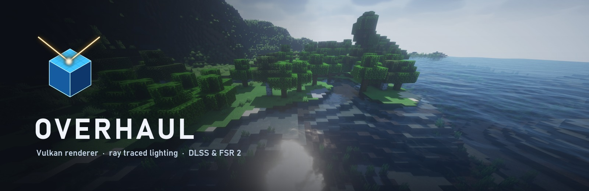
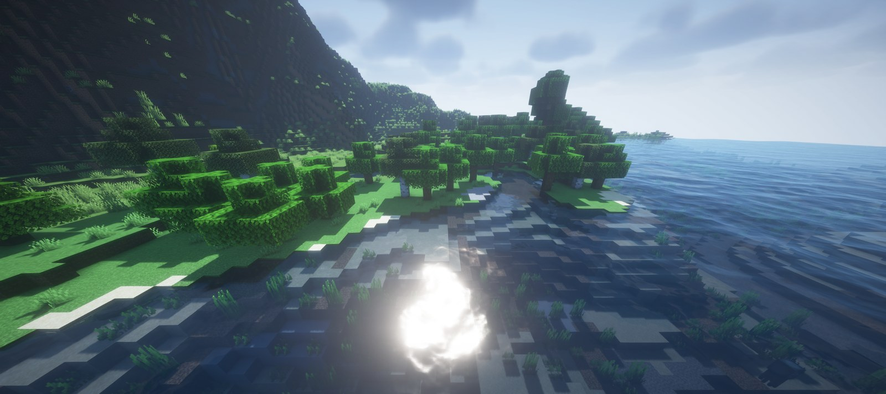
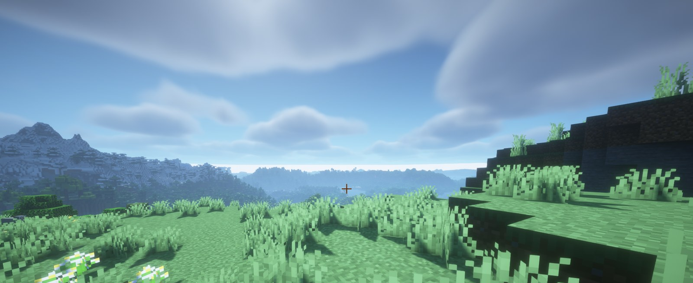
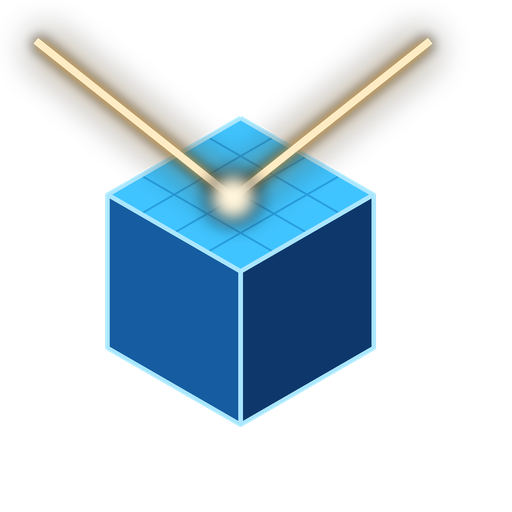

<p align="center">
  
</p>

<p align="center">
  <a href="https://github.com/redstone-md/Overhaul/releases"></a>
  
  
  
  <a href="LICENSE"></a>
</p>

# Overhaul

Overhaul is a Vulkan renderer for Minecraft. It replaces the game's OpenGL
renderer with its own Vulkan device, adds ray traced lighting and upscaling, and
gives the game a new video settings screen.

> **Alpha.** This is an early release. Expect rendering bugs and mod conflicts,
> and keep backups of your worlds.

## Features

- **Native Vulkan renderer.** Overhaul talks to Vulkan directly. It does not
  translate OpenGL calls, so it is not a Zink-style layer.
- **Ray traced lighting** on GPUs with Vulkan ray queries:
  - sun shadows;
  - reflections on water, glass and ice;
  - one-bounce global illumination, traced at half resolution and accumulated
    over frames.
- **Upscaling and anti-aliasing:**
  - NVIDIA DLSS (via Streamline) on RTX GPUs;
  - AMD FSR 2 on any GPU;
  - FXAA and contrast-adaptive sharpening.
- **Shader packs** in the Iris/OptiFine format, such as BSL and Complementary.
  You can turn them on or off without restarting.
- **Performance overlay** for FPS, frame time, 1% lows, a frame graph and GPU
  time. It is toggled with F10 by default, and its contents and position can be
  changed.
- **Built-in benchmark.** It creates a world from a fixed seed, so every machine
  measures the same land, charts the result and then deletes the world.
- **Every optimisation can be switched off** from the settings screen, so you can
  find out which one causes a problem.

All options are under **Options → Video Settings**, which opens the Overhaul
screen. Its pages are Quality, Video, Upscaling, Optimization, Overlay and Shader
Packs, and changes apply while you play.

## Screenshots

<p align="center">
  
  <br><em>Sunlight on shallow water, with the BSL shader pack.</em>
</p>

<p align="center">
  
  <br><em>Grass shadows and volumetric clouds, with the BSL shader pack.</em>
</p>

## Performance

These are rough numbers from one machine, not a promise:

- The test was a NeoForge 1.21.1 pack with 332 mods and Distant Horizons.
- With Overhaul, the scene averaged about **385 FPS**.
- The same scene averaged about **57 FPS** on the vanilla renderer.
- Ray tracing and shader packs cost frames, as they do in any renderer.

## Requirements

- Minecraft **1.21.1** with **NeoForge 21.1.x**.
- Windows x64.
- A GPU and driver with **Vulkan 1.2**.
- For ray tracing: Vulkan ray query support, such as NVIDIA RTX 20 series or
  newer, or AMD RX 6000 series or newer.
- For DLSS: an NVIDIA RTX GPU.

**Do not install Sodium, Embeddium, Iris or Oculus alongside Overhaul.** It
replaces the renderer they patch, and they will conflict.

## Install

1. Download `overhaul-neoforge-1.21.1-blaze-client-windows-<version>.jar` from
   [Releases](https://github.com/redstone-md/Overhaul/releases).
2. Put the jar in your instance's `mods` folder.
3. Start the game.
4. Open **Options → Video Settings** to set it up.

## Building

Builds need JDK 25. The Gradle wrapper downloads everything else.

```powershell
.\gradlew.bat -p platform-adapters/minecraft "-Ptarget=neoforge-1.21.1" -PblazeBackend "-PloaderVersionOverride=21.1.265" assemble
```

The jar is written to `platform-adapters/minecraft/build/neoforge-1.21.1-blaze/libs/`.

DLSS support is only included when you pass a path to an extracted
[NVIDIA Streamline SDK](https://github.com/NVIDIA-RTX/Streamline/releases) with
`-PstreamlineSdk=<dir>`. Without it the build still works, but the DLSS option
stays unavailable. Release builds use Streamline v2.14.16; see
[`.github/workflows/release.yml`](.github/workflows/release.yml).

Releases are built automatically when a `v*` tag is pushed.

## Repository layout

| Path | Contents |
| --- | --- |
| `vulkan-backend/` | Vulkan device, memory, swapchain and command code |
| `shader-pipeline/` | Shader pack parsing, GLSL lowering and SPIR-V compilation |
| `core-common/` | Loader-independent world processing and shared engine code |
| `platform-adapters/minecraft/` | Loader adapters; the NeoForge renderer is in `src/blazeBackend` |
| `docs/` | Architecture notes and validation records |

See [docs/ARCHITECTURE.md](docs/ARCHITECTURE.md) and [roadmap.md](roadmap.md)
for more detail.

## License

Overhaul is licensed under the [GNU General Public License v3.0](LICENSE).

Release jars also include third-party components under their own licenses:

- **AMD FidelityFX FSR 2** (MIT). Its license is in
  `overhaul/fsr2/LICENSE.txt` inside the jar.
- **NVIDIA Streamline and DLSS.** Their license texts are in
  `overhaul/streamline/` inside the jar. NVIDIA, RTX and DLSS are trademarks of
  NVIDIA Corporation.

Overhaul is not affiliated with Mojang, Microsoft, NVIDIA or AMD.

<p align="center">
  
</p>
