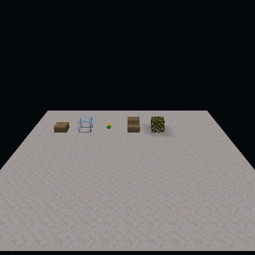
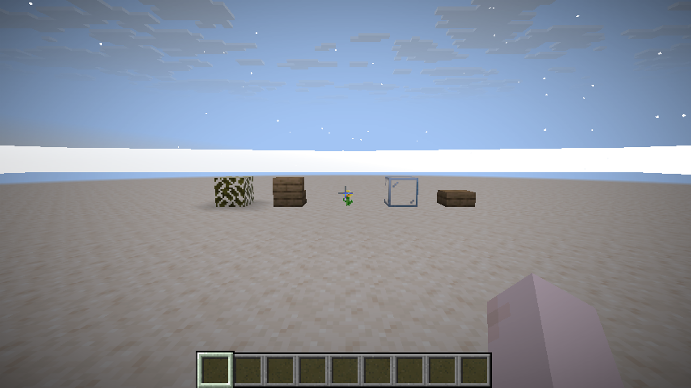

# Validation checkpoint: 2026-11-03

Local platform: Windows, Temurin JDK 25.0.3, NVIDIA GeForce RTX 5070.
The worktree began empty; no existing launcher instance or save was modified.

## Engine

The combined command passed:

```powershell
.\gradlew.bat build :integration-tests:nativeTest :vulkan-backend:vulkanSmoke --args="--present --output build/verification/triangle.ppm"
```

| Suite | Tests | Failures | Skipped |
| --- | ---: | ---: | ---: |
| core-common | 22 | 0 | 0 |
| shader-pipeline | 16 | 0 | 0 |
| platform-adapters | 3 | 0 | 0 |
| vulkan-backend | 7 | 0 | 0 |
| native integration | 17 | 0 | 0 |
| experimental Fabric 26.3 backend native | 17 | 0 | 0 |
| backend read-range unit | 2 | 0 | 0 |

Source files are below 500 lines, and the engine module import-boundary gate passes.

The native smoke verified exact 65,536-byte staging/device/readback transfer;
indexed indirect depth-tested drawing; 11 transfers across three fenced slots;
multi-draw and single-draw fallback with three instances; sparse visibility changes
and restoration without geometry copies; and 62 geometry presentations across
resize using acquire/present semaphores. The reference triangle covered 5,202
pixels with CRC32 `835141031` on this device.

The native integration tests cover worker-built chunk geometry after source slabs
are overwritten, native graph image barriers, and unchanged pinned Iris example
basic/textured programs. Pixel checks exercise uniform updates, texture rows,
OpenGL-to-Vulkan clip conversion and blend state. PNGs were visually inspected at:

- `integration-tests/build/verification/chunk-vulkan.png`
- `integration-tests/build/verification/iris-basic.png`
- `integration-tests/build/verification/iris-basic-blended.png`
- `integration-tests/build/verification/iris-textured.png`
- `integration-tests/build/verification/iris-textured-toprow.png`

Khronos validation layers were unavailable. These results are native execution
checks without validation layers, not a claim of cross-device correctness.

The isolated `:vulkan-backend:sdlVulkanSmoke` also passes real SDL3/Vulkan
readback, 52 instanced presentations and resize on LWJGL 3.4.3+4, with no GLFW
class on that runtime. Borrowed-window ownership and rejection of non-Vulkan SDL
windows are checked. The separate `-sdl34.jar` contains the provider, not its smoke
launcher or native libraries.

## Loader packaging

The serial runner passed all 11 pinned targets with 22 tests, without source drift:

| Loader | Minecraft versions |
| --- | --- |
| Fabric | 1.16.5, 1.20.1, 1.21.1, 26.3 |
| Forge | 1.12.2, 1.16.5, 1.20.1, 1.21.1, 26.3 |
| NeoForge | 1.21.1, 26.3 |

The [retained receipts](evidence/loader-targets-2026-11-03.json) contain per-jar
SHA-256 values and a shared raw-source digest. `verify-targets.ps1 -CheckReceipts`
subsequently confirmed those sources and every existing jar still match. These
pins represent the requested eras; they do not cover every intervening release.
The dedicated-server entrypoint tests forbid loading client/native packages.
Legacy CoreMod fixtures are transformed and executed in tests; a real Java 8
Minecraft 1.12.2 runtime has not been exercised.

## Actual client lifecycle

This command passed with exit code zero:

```powershell
.\gradlew.bat -p platform-adapters/minecraft '-Ptarget=fabric-26.3' '-PsmokeClient=200' runClient --console=plain --no-configuration-cache
```

Fabric loaded the adapter, initialized the actual game window, textures and sound,
ran the diagnostic hook for 200 ticks, then invoked the game's own `stop()` method
and shut down normally. An earlier launch exposed an overly broad Mixin namespace;
the package was narrowed and a jar invariant was added before the successful run.

That menu test reported its vanilla OpenGL backend and did not enter a world.
The subsequent test below establishes actual world capture and native asset
rendering. Desktop automation remained unavailable, so no screenshot of the
game window or full gameplay parity check has been claimed.

## Live world and native baked models

The latest-code command passed with exit code zero:

```powershell
.\gradlew.bat :vulkan-backend:jar :shader-pipeline:jar
.\gradlew.bat -p platform-adapters/minecraft '-Ptarget=fabric-26.3' -PworldSmoke -PmodelSmoke verifyWorldSmoke --console=plain --no-configuration-cache
```

The integrated server created a new world inside the isolated development run
directory, placed a slab, glass, a flower, stairs and leaves on its server thread,
and the client confirmed all five packet states before capture. Revision two
superseded revision one and was accepted with nonempty geometry.

The actual game tessellator then supplied 283 baked quads, including 19 with
non-integer geometry, nine cutout quads and five translucent quads. GPU callbacks
copied the real 2048x2048 block atlas and 16x16 lightmap into owned bytes. A bounded
worker packed and uploaded 1,698 indices, released and overwrote its source slab,
then rendered the same pixels twice through Overhaul's Vulkan model path. The
512x512 image had 132,868 non-background pixels and was visually inspected:



The [receipt and artifact hashes](evidence/world-model-2026-11-03.json) retain the
source commit, native jar hashes, image hash, world identity, exact fixture states
and zero-lease teardown result. The game saved, disconnected and stopped normally.
The game window remained on vanilla OpenGL: the Vulkan result is an offscreen
draw of its captured assets, not a replacement for its onscreen renderer.

Additional native tests verify partial mapped writes, preserved opaque/cutout
indices, correct translucent blend ordering and no upload for a stationary camera.
The mixed-layer fixture uploads 48 translucent index bytes on movement instead of
the full 96-byte index buffer. This is a measured transfer count for that fixture,
not an FPS claim.

## Actual Overhaul game backend

The opt-in Fabric 26.3 commands passed:

```powershell
.\gradlew.bat :vulkan-backend:assemble :shader-pipeline:jar
.\gradlew.bat -p platform-adapters/minecraft '-Ptarget=fabric-26.3' -PoverhaulBackend build backendNativeTest --console=plain --no-configuration-cache
.\gradlew.bat -p platform-adapters/minecraft '-Ptarget=fabric-26.3' -PoverhaulBackend '-PsmokeClient=200' verifyBackendSmoke --console=plain --no-configuration-cache
.\gradlew.bat -p platform-adapters/minecraft '-Ptarget=fabric-26.3' -PoverhaulBackend -PworldSmoke verifyWorldSmoke verifyBackendSmoke --console=plain --no-configuration-cache
```

The actual game logged `Using graphics backend Overhaul Vulkan`. Its factory
created the device before the SDL window. All native resources, pipelines,
commands and presentation use Overhaul; the shared game frontend supplies shader
compilation/validation. The backend list contains no fallback.

Nine native tests pass with LWJGL's debug allocator enabled. They verify actual
frontend shader compilation, UBO/image/texel descriptors, MRT masks, depth
load/test/write, push constants, direct/indexed/indirect/multi-draw results,
logical-close pins, nullable vertex-slot unbinding, mapping/transient reuse,
pitched/mip transfers, partial clears, timestamps, SDL acquire/blit/present,
resize and borrowed-window ownership. Three additional portable native tests
cover images/mapped ranges. The existing renderer smoke paths still pass.

The 200-tick GUI run rendered accessibility onboarding, panorama, text and buttons,
then stopped normally. Its [receipt](evidence/backend-screen-2026-11-03.json) and
[GPU image](evidence/backend-screen-2026-11-03.png) are retained. Inspection exposed
a missing presentation Y inversion, which was corrected before the retained run.

The live-world run verified all five server-to-client fixture states and latest
snapshot revision. It rendered world terrain, clouds, hand, HUD and fixture
models through the actual selected backend, then saved, disconnected and closed
with zero snapshot leases. The [world receipt](evidence/backend-world-2026-11-03.json),
[fixture receipt](evidence/backend-world-fixture-2026-11-03.json) and image are retained:



The [evidence manifest](evidence/backend-2026-11-03.json) records matching source
commits, native jar/image hashes, commands, test counts and the server-owned
reference camera pose.

These images are readbacks of the actual source passed to the swapchain blit,
with its presentation Y inversion applied; they are not desktop screenshots.
The test does not cover every entity/particle/weather path, long sessions,
reloads, dimensions or mod coexistence. That initial checkpoint used synchronous
submission; the asynchronous increment below supersedes it. Performance remains
unmeasured against a controlled reference.
No Khronos validation layers were available.

Adapter builds/clients must run serially: switching the same Gradle project to
another variant can clean the previous output directory while a client still
loads its classes. The final world checks ran without concurrent adapter builds.

## Bounded asynchronous game commands

The same GUI and disposable-world commands pass after removing per-pass waits.
An ordered queue batches passes, buffer copies, image operations and timestamp
commands on three fenced slots. Pins, descriptors and attachment views survive
until the owning fence completes; failed batches restore image layouts in reverse
order and do not publish callbacks or timestamp generations. CPU buffer access
waits only for overlapping work, respecting non-coherent atom granularity.
Transient arenas rotate over three frames under their shared memory budget.

Fence markers stay in their batch until submission; polling unsubmitted work
returns pending. A nonzero wait can submit it. This avoids premature submissions
from game resource-pool fences. Readback completion callbacks may safely map or
enqueue work. Private attachment views retire at their own fence and do not wait
for later image-only presentation blits.

New native cases verify real timed-out GPU work held by a native event, retirement
exactly once, many markers sharing a submission, older receipt retirement,
disjoint maps, copied-data ordering, source snapshot ownership, callback reentry,
rollback/recovery, stale query generations and private-view versus image lifetime.
The interval unit checks compare merged ranges with an independent byte oracle.
SDL verification additionally presents 24 asynchronous split frames over three
acquire slots and exercises resize, abandoned acquisition and close.

The [async world receipt](evidence/backend-async-world-2026-11-03.json) records:

| Counter | Observed |
| --- | ---: |
| Presented frames / native blits | 359 |
| Render passes / draws | 2,900 / 26,899 |
| Rendering queue submissions / operations | 403 / 21,324 |
| Rendering queue positive-timeout fence waits | 27 |
| Presentation positive-timeout fence waits | 1 |
| Synchronous verification submissions / waits | 1 / 1 |

Counters include startup and shutdown. A positive-timeout wait invocation may
return immediately; these numbers do not measure blocked time, FPS or frame-time
gains. Rendering submissions exclude the separate swapchain blit per frame.
The one synchronous submission reads the debug image. All five block fixtures
and zero snapshot leases were verified before normal save/disconnect and close.
The latest [world image](evidence/backend-async-world-2026-11-03.png),
[GUI image](evidence/backend-async-screen-2026-11-03.png) and
[manifest](evidence/backend-async-2026-11-03.json) retain this checkpoint.
Static buffers remain host-visible; descriptor/framebuffer pooling, allocation
profiling and controlled reference benchmarks remain open.

## Remaining evidence

Remote CI has not executed. Complete Minecraft Vulkan scene parity, full shader
packs, actual world-generation/loading/lighting/tick changes, all render domains,
remaining versions, ecosystem parity and controlled performance comparisons are
still required. See `IMPLEMENTATION_STATUS.md` and `roadmap.md`.
