
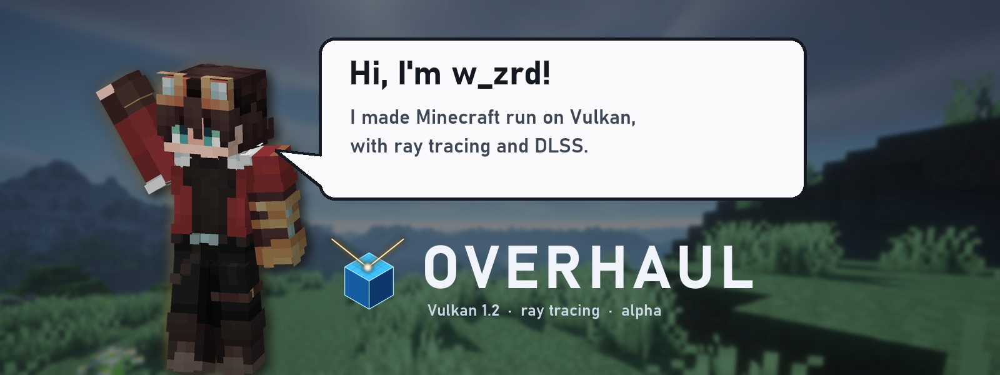

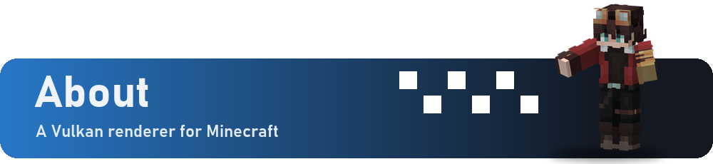

Overhaul replaces Minecraft's OpenGL renderer with a **native Vulkan renderer**. It adds ray traced lighting, DLSS and FSR 2 upscaling, and a new video settings screen. It talks to Vulkan directly and does not translate OpenGL calls.

> **Alpha.** Expect rendering bugs and mod conflicts, and keep backups of your worlds.

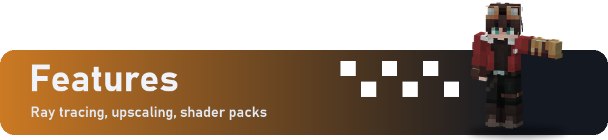

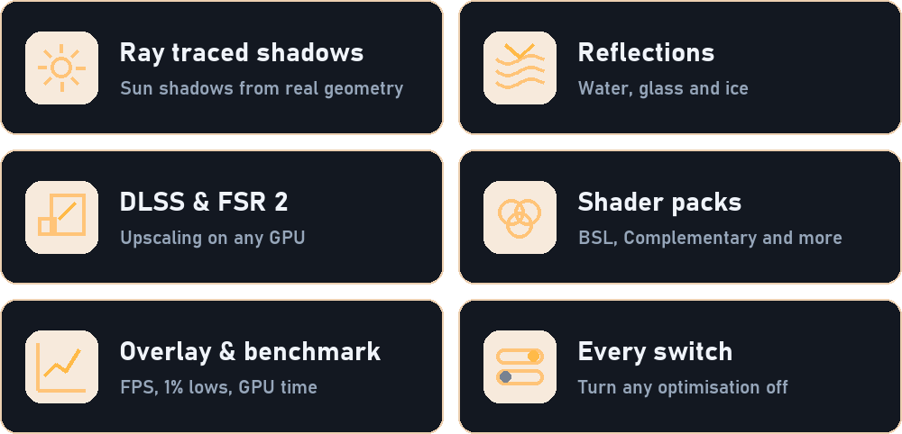

- **Ray traced lighting** on GPUs with Vulkan ray queries: sun shadows, reflections on water, glass and ice, and one-bounce global illumination.
- **Upscaling:** NVIDIA DLSS on RTX GPUs, AMD FSR 2 on any GPU, plus FXAA and sharpening.
- **Shader packs** in the Iris/OptiFine format, such as BSL and Complementary. Turn them on or off without restarting.
- **Performance overlay** (F10) and a **built-in benchmark** on a fixed seed.

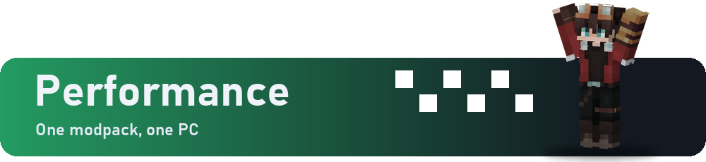

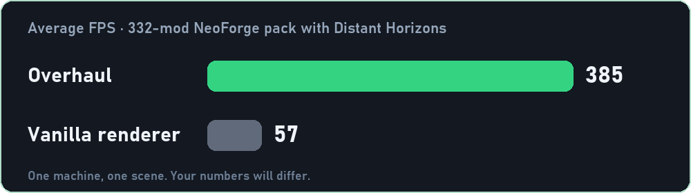

Ray tracing and shader packs lower these numbers, as in any renderer.

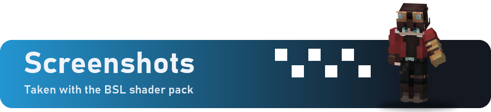

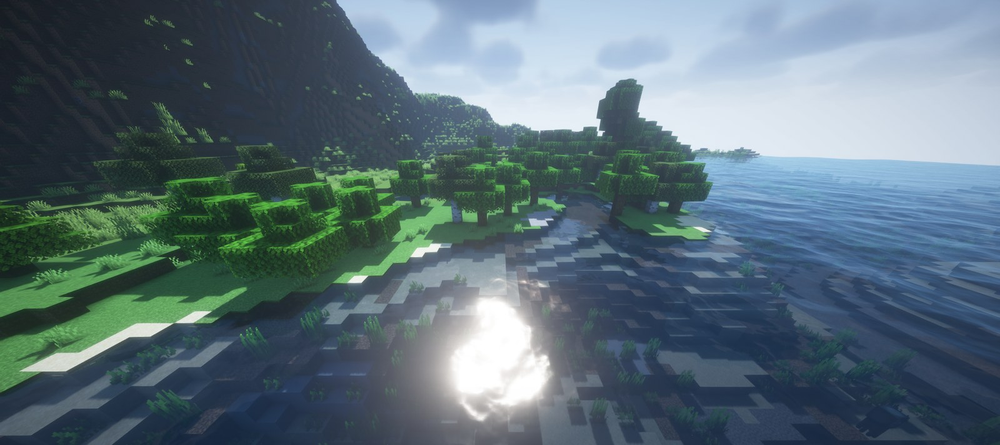

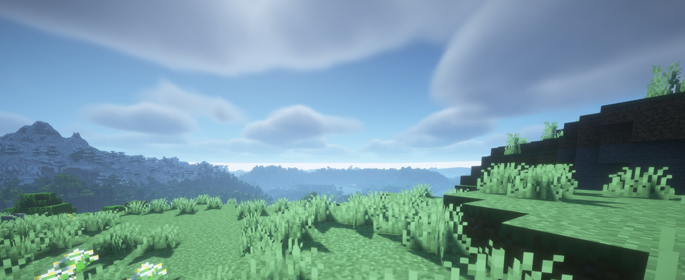

- For now: Minecraft **1.21.1** with **NeoForge 21.1.x**, on Windows x64.
- A GPU and driver with **Vulkan 1.2**.
- Ray tracing: NVIDIA RTX 20 series or newer, or AMD RX 6000 series or newer.
- DLSS: an NVIDIA RTX GPU.

**Do not install Sodium, Embeddium, Iris or Oculus alongside Overhaul.** It replaces the renderer they patch.

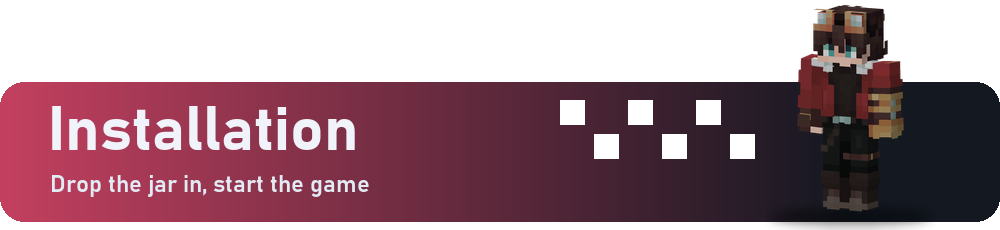

1. Put the jar in your `mods` folder.
2. Start the game.
3. Open **Options → Video Settings**. Every page applies its changes while you play.

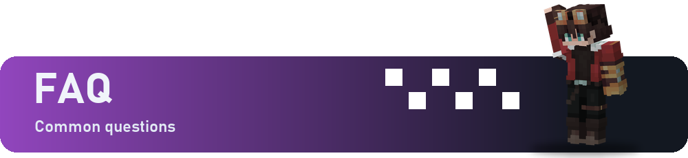

**Does it work with Fabric or other Minecraft versions?** Not yet. The first build is for NeoForge 1.21.1. More Minecraft versions and loaders, Fabric and Forge among them, are planned.

**Do I need it on the server?** No. Overhaul is client-side only.

**My GPU has no ray tracing. Can I still use it?** Yes. Ray tracing switches off and the rest of the renderer still works.

**Something looks wrong.** Open an [issue](https://github.com/redstone-md/Overhaul/issues) with your GPU, driver version and `logs/latest.log`.

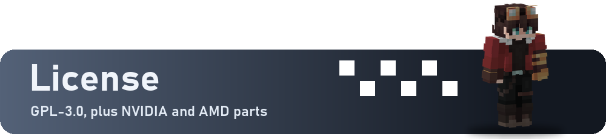

Overhaul is licensed under the GPL-3.0. Release jars include AMD FidelityFX FSR 2 (MIT) and NVIDIA Streamline and DLSS under their own licenses. NVIDIA, RTX and DLSS are trademarks of NVIDIA Corporation. Overhaul is not affiliated with Mojang, Microsoft, NVIDIA or AMD.

<a href="https://github.com/redstone-md/Overhaul/issues">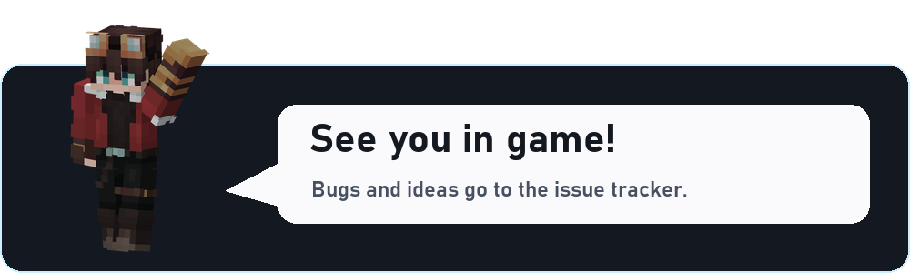</a>

